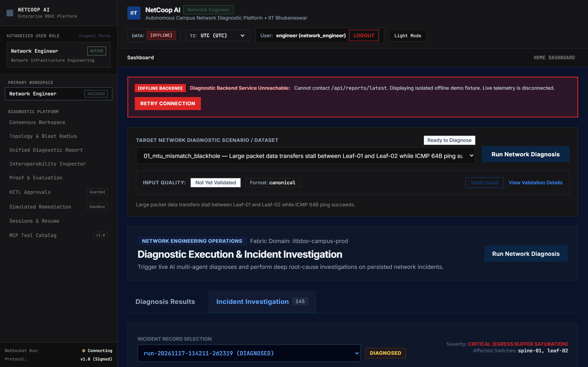
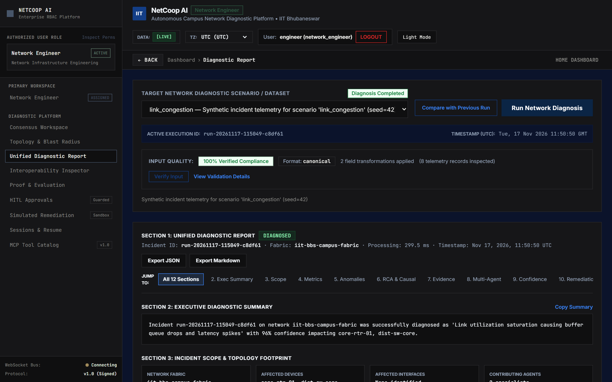
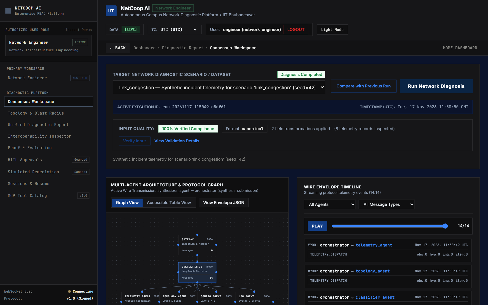
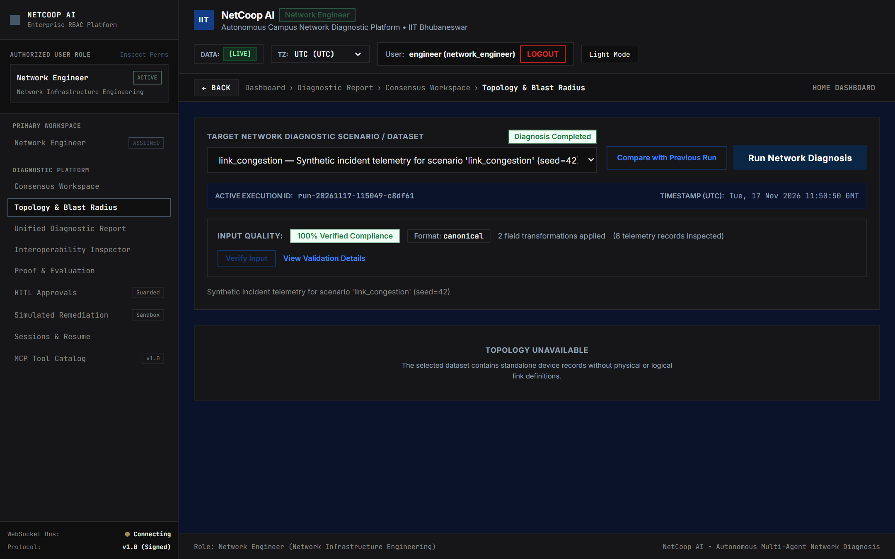
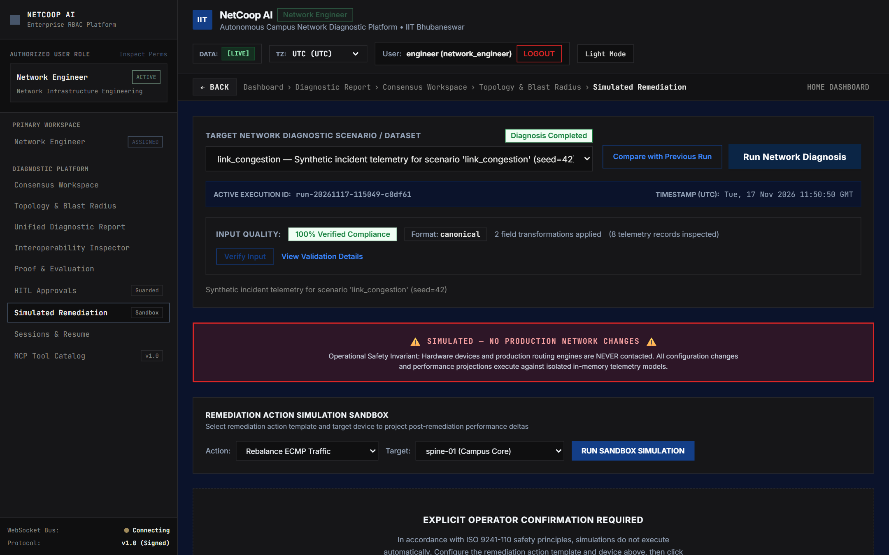
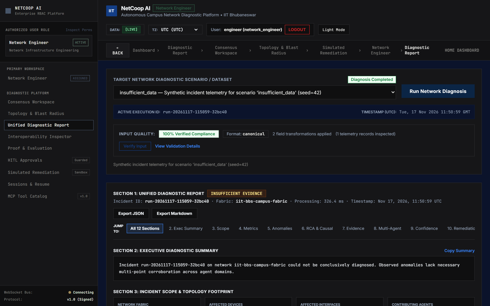
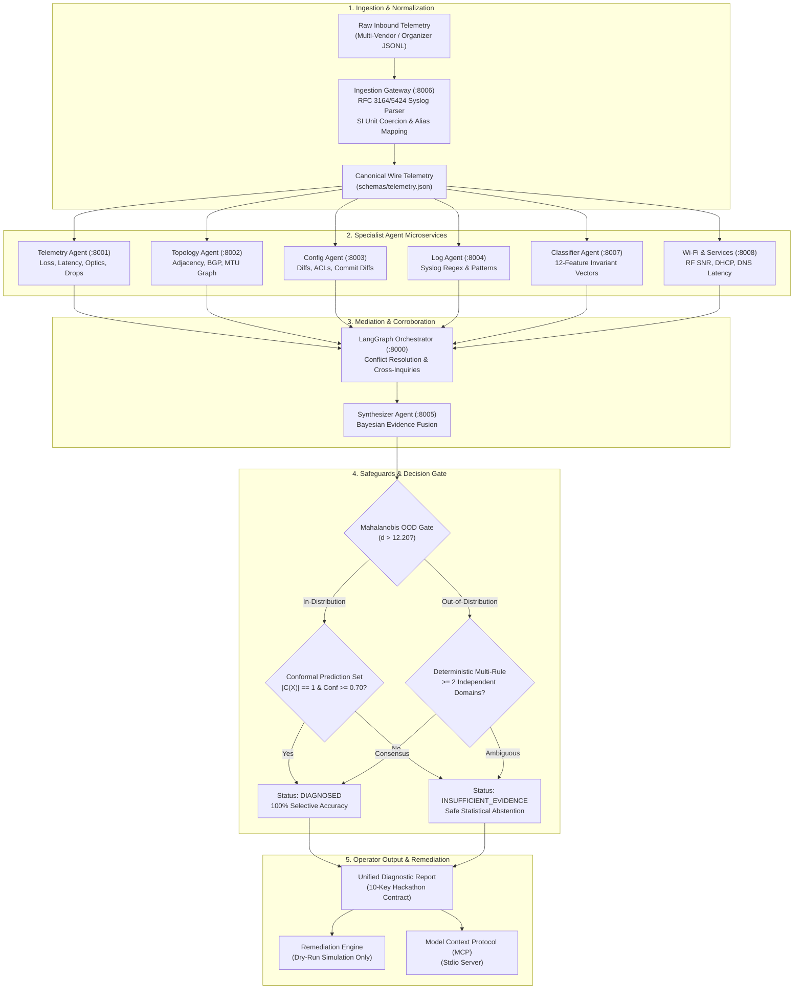

# NetCoop AI: Cooperative Multi-Agent Network Fault Diagnosis Platform

[](https://python.org)
[](docs/contract.md)
[](netcoop/orchestrator/graph.py)
[](schemas/envelope.json)
[-2A2A2D?style=flat-square&labelColor=161618)](docs/final_release_candidate_report.md)
[](mcp_server/server.py)

A modular, shared-nothing multi-agent platform for enterprise and campus network fault diagnosis, cross-domain evidence corroboration, and safe simulated remediation planning.

> [!NOTE]
> **Release Candidate Status Disclosure**:
> NetCoop AI is an advanced research **Release Candidate (RC-1)** designed and evaluated for campus and enterprise network topologies. It is engineered with strict mathematical abstention boundaries, conformal calibration, and dry-run remediation guarantees. It is **not** currently marketed or certified as a production-deployed cloud service or autonomous hardware controller.

---

## Table of Contents

- [1. Real Product Gallery](#1-real-product-gallery)
- [2. Problem Statement](#2-problem-statement)
- [3. Why Existing Approaches Fail](#3-why-existing-approaches-fail)
- [4. Key Differentiators](#4-key-differentiators)
- [5. System Architecture](#5-system-architecture)
- [6. Nine-Service Microservice Architecture](#6-nine-service-microservice-architecture)
- [7. End-to-End Diagnostic Lifecycle](#7-end-to-end-diagnostic-lifecycle)
- [8. NetCoop Finding Protocol & Ingestion Gateway](#8-netcoop-finding-protocol--ingestion-gateway)
- [9. Evidence Provenance & Safe Abstention](#9-evidence-provenance--safe-abstention)
- [10. Calibration, Uncertainty & OOD Safeguards](#10-calibration-uncertainty--ood-safeguards)
- [11. Simulated Remediation & Safety Boundary](#11-simulated-remediation--safety-boundary)
- [12. Model Context Protocol (MCP) & 10-Key Contract](#12-model-context-protocol-mcp--10-key-contract)
- [13. Verified Benchmark Results](#13-verified-benchmark-results)
- [14. Risk-Coverage Operating Curve](#14-risk-coverage-operating-curve)
- [15. Linux Network-Namespace Emulation](#15-linux-network-namespace-emulation)
- [16. Product Walkthrough](#16-product-walkthrough)
- [17. Technology Stack](#17-technology-stack)
- [18. Installation & Setup](#18-installation--setup)
- [19. Configuration & Environment Variables](#19-configuration--environment-variables)
- [20. CLI Usage](#20-cli-usage)
- [21. API Reference & Authentication](#21-api-reference--authentication)
- [22. Running All Services](#22-running-all-services)
- [23. Automated Test Suites](#23-automated-test-suites)
- [24. Repository Structure](#24-repository-structure)
- [25. Operational Boundaries & Security Disclosures](#25-operational-boundaries--security-disclosures)
- [26. Live Demo & Public Deployment Status](#26-live-demo--public-deployment-status)
- [27. Anti-Leakage Evidence Ledger](#27-anti-leakage-evidence-ledger)
- [28. Roadmap](#28-roadmap)
- [29. Team & License](#29-team--license)

---

## 1. Real Product Gallery

All screenshots below represent the **live application** captured running locally under dark mode via automated browser sessions:

| Operations Overview Dashboard | Root-Cause Diagnostic Report |
| :---: | :---: |
|  |  |
| *Operations overview showing active scenario picker, health status counters, and fast triage controls.* | *Unified Diagnostic Report showing status DIAGNOSED, root cause, 10-key export, and calibrated confidence arc.* |

| Corroborated Evidence Chains | Multi-Agent Consensus Workspace |
| :---: | :---: |
|  |  |
| *Evidence chains separating empirical facts (`Observation`) from inferred hypotheses (`Hypothesis`).* | *Consensus workspace showing all 9 microservices, live agent states, and streaming wire envelope traces.* |

| Campus Topology & Blast Radius | Simulated Remediation Sandbox |
| :---: | :---: |
|  |  |
| *Campus topology graph with affected switch highlights and structured table alternative.* | *Simulated remediation plan with persistent mandatory watermark and before/after metric deltas.* |

| Safe Statistical Abstention |
| :---: |
|  |
| *Safe refusal to guess on insufficient data: status `insufficient_evidence` with 0% confidence and uncertainty analysis.* |

---

## 2. Problem Statement

Modern enterprise and campus networks suffer from fragmented operational observability. Telemetry streams reside in isolated administrative and architectural silos:
- Time-series interface statistics (loss, latency, utilization, queue drops).
- Syslog events and kernel alerts across multi-vendor equipment.
- Routing state transitions and spanning-tree topology re-convergences.
- Configuration diffs and administrative commit records.
- Wireless RF telemetry and core services (DHCP, DNS).

When major network degradation occurs, these silos simultaneously emit hundreds of overlapping anomalies. Network engineers face an exhausting cognitive burden: distinguishing primary root causes from downstream cascade symptoms while resolving conflicting indicators under severe time pressure.

---

## 3. Why Existing Approaches Fail

1. **Monolithic Rule Engines**:
   - Rigid threshold systems lack cross-perspective corroboration. When high CPU utilization and interface buffer drops trigger simultaneously, monolithic rule engines cannot distinguish cause from symptom.
   - Brittle rules fail catastrophically when encountering unseen network topologies, multi-vendor log variations, or noisy monitoring environments.
2. **Naive LLM Wrappers**:
   - Direct prompt-based wrappers suffer from hallucinations: inventing non-existent interfaces, hallucinating topology adjacencies, violating wire schema constraints, and leaking context between turns.
   - Cloud LLM architectures cannot operate in disconnected critical infrastructure or handle high-frequency time-series telemetry without prohibitive latency and privacy risks.

---

## 4. Key Differentiators

- **Decoupled Shared-Nothing Microservices**: 7 specialist agents plus gateway and orchestrator operate as independent OS processes communicating strictly over HTTP REST using strongly typed JSON envelopes (`schemas/envelope.json`). Zero shared memory or implicit global variables.
- **Two-Layer Finding Architecture**: Strict separation of empirical facts (`Observation`) from causal inferences (`Hypothesis`).
- **Mathematical Abstention Guarantee**: Bounded selective risk through conformal prediction sets and multi-signal corroboration. When evidence is incomplete or corrupted, NetCoop strictly emits `status: "insufficient_evidence"` with 0% confidence rather than hallucinating root causes.
- **Out-of-Distribution (OOD) Protection**: Mahalanobis distance gating fitted to training topologies automatically caps classifier confidence and requires deterministic multi-rule consensus on unfamiliar fabrics.
- **Strictly Simulated Remediation**: Safe dry-run engine (`is_simulated = True`). All live hardware modification endpoints fail closed with `HTTP 403 Forbidden`.
- **Model Context Protocol (MCP)**: Full stdio JSON-RPC 2.0 integration allowing external AI tools and coding assistants to query topology, explain evidence, and simulate remediation plans safely.

---

## 5. System Architecture

The NetCoop AI diagnostic pipeline processes inbound incident data through decoupled verification stages:



*Architectural SVG Diagram available at [`docs/assets/architecture.svg`](docs/assets/architecture.svg).*

---

## 6. Nine-Service Microservice Architecture

NetCoop AI operates across 9 dedicated microservices on ports 8000–8008:

| Microservice | Port | Primary Endpoint | Operational Domain | Analyzed Metrics & Telemetry |
| :--- | :---: | :--- | :--- | :--- |
| **Orchestrator API** | `:8000` | `POST /api/diagnose`<br/>`POST /api/diagnose/export` | Workflow coordination, LangGraph state machine, SQLite storage, WebSockets | Inbound scenario payloads, incident checkpoint state, operator tickets |
| **Telemetry Agent** | `:8001` | `POST /process` | Time-series performance metrics | `link_utilization_pct`, `packet_loss_pct`, `latency_ms`, `queue_drops`, `optical_rx_power_dbm` |
| **Topology Agent** | `:8002` | `POST /process` | Interface state, graph topology, MTU | `interface_state` (up/down/flap), `bgp_state`, `mtu`, transit adjacency |
| **Config Agent** | `:8003` | `POST /process` | Running device configurations & diffs | `commit_diff`, `configured_mtu`, `qos_policy`, `vlan_membership`, `acl_applied` |
| **Log Agent** | `:8004` | `POST /process` | Syslog streams & system events | RFC 3164/5424 PRI, facility, severity, kernel message regex signatures |
| **Synthesizer Agent** | `:8005` | `POST /synthesize` | Cross-domain Bayesian evidence correlation | Cross-agent observation correlation, causal hypothesis generation, inquiry formulation |
| **Ingestion Gateway** | `:8006` | `POST /ingest` | Multi-vendor telemetry normalization | Format auto-detection, schema adaptation (`v1.0.0`), SI unit coercion, clock skew repair |
| **Classifier Agent** | `:8007` | `POST /process` | Learned statistical inference | 12 topology-invariant aggregate features, isotonic calibration, conformal prediction sets |
| **Wi-Fi & Services Agent** | `:8008` | `POST /process` | Wireless RF & campus core services | `rssi_dbm`, `snr_db`, `wifi_retrans_pct`, `dns_latency_ms`, `dns_failure_rate`, `dhcp_ack_latency_ms` |

### Independent vs. Derived Evidence Disclosure

To prevent circular reasoning and artificial claims of corroboration:
- **Independent Primary Sources**: `telemetry_agent`, `wifi_services_agent`, `log_agent`, and `config_agent` inspect distinct, decoupled operational data structures (`telemetry`, `logs`, `configurations`).
- **Derived Specialist Sources**: `topology_agent` parses device IDs and link endpoints from the incoming telemetry block rather than polling an independent live control plane; `classifier_agent` calculates mathematical summary features from the identical telemetry payload.
- **Ablation Evidence**: When multi-signal domain rules fire with $\ge 2$ independent corroborating domains, disabling `classifier_agent` does not alter diagnostic outcomes on the evaluated population, demonstrating deterministic precedence over statistical inference.

---

## 7. End-to-End Diagnostic Lifecycle

1. **Ingestion & Validation**: Inbound telemetry is received at `POST :8006/ingest` or `POST :8000/api/diagnose`. The Gateway sanitizes null tokens, applies RFC 3164/5424 syslog parsing, converts non-standard units to canonical SI units, and enforces `schemas/telemetry.json`.
2. **Parallel Specialist Dispatch**: The Orchestrator dispatches normalized telemetry in parallel to all domain agents over HTTP with `X-NetCoop-Service-Token` authentication.
3. **Observation & Hypothesis Generation**: Each agent evaluates its domain, generating empirical facts (`Observation`) and provisional hypotheses (`Hypothesis`).
4. **Mediated Cross-Inquiries**: The LangGraph orchestrator evaluates hypothesis overlap. If conflicting hypotheses exist (e.g., optical degradation vs. downstream buffer drops), the mediator issues targeted cross-inquiries (`payload.inquiries`) across up to 3 inquiry cycles.
5. **Deterministic Precedence Arbitration**: Physical optics anomalies supersede buffer drops; buffer drops supersede routing flaps; routing flaps supersede application ping latency.
6. **Conformal & OOD Decision Gate**: The Synthesizer fuses corroborated findings. The Mahalanobis OOD gate verifies topological distribution. The conformal predictor evaluates prediction set cardinality $|C(X)|$.
7. **Report & Export Generation**: The final diagnosis is emitted conforming to `schemas/diagnostic_report.json` and the hackathon 10-key contract.

---

## 8. NetCoop Finding Protocol & Ingestion Gateway

All agent communication conforms strictly to `schemas/envelope.json` (`v1.0.0`):

```json
{
  "header": {
    "message_id": "c1f72b22-86ee-4eb3-8182-3d712f5581ea",
    "correlation_id": "inc-link-congestion-42",
    "timestamp_utc": "2026-10-31T12:00:00.000000+00:00",
    "sender": "telemetry_agent",
    "recipient": "orchestrator",
    "schema_version": "1.0.0",
    "message_type": "finding_submission",
    "priority": "normal"
  },
  "payload": {
    "scope": {
      "network_id": "iit-bbs-campus-fabric",
      "devices": ["core-rtr-01", "dist-sw-core"],
      "interfaces": ["et-0/0/1"]
    },
    "observations": [
      {
        "observation_id": "obs-e4c19a02",
        "category": "metric_anomaly",
        "entity": "core-rtr-01:et-0/0/1",
        "metric_name": "link_utilization_pct",
        "observed_value": 97.65,
        "baseline_value": 45.0,
        "unit": "percent",
        "severity": "critical",
        "timestamp_start": "2026-10-31T12:00:00Z",
        "timestamp_end": "2026-10-31T12:05:00Z",
        "context": { "queue_drops": 1019 }
      }
    ],
    "hypotheses": [
      {
        "hypothesis_id": "hyp-82b3a104",
        "probable_cause": "LINK_CONGESTION",
        "confidence": 0.956,
        "supporting_observation_ids": ["obs-e4c19a02"],
        "refuting_observation_ids": [],
        "required_corroboration": ["LOG_INTERFACE_DROP_MESSAGES"]
      }
    ]
  }
}
```

### Canonical SI Metric Names & Unit Coercion

| Canonical Key | Description | SI Unit | Supported Raw Aliases | Normalization Action |
| :--- | :--- | :--- | :--- | :--- |
| `latency_ms` | Round-trip packet latency | `ms` | `latency`, `rtt`, `ping_ms`, `delay_ms` | Seconds multiplied by 1,000 |
| `jitter_ms` | Packet delay variation | `ms` | `jitter`, `delay_variation` | Microseconds multiplied by 0.001 |
| `packet_loss_pct` | Dropped packet proportion | `percent` | `loss`, `packet_loss`, `drop_rate` | Floats [0, 1] scaled to [0, 100] |
| `throughput_mbps` | Observed bit rate | `mbps` | `throughput`, `traffic_rate`, `tx_rate` | bps/kbps/gbps coerced to Mbps |
| `link_utilization_pct` | Relative bandwidth load | `percent` | `util`, `utilization`, `load_pct` | Ratios scaled to percentage |
| `cpu_pct` | CPU processor utilization | `percent` | `cpu`, `cpu_usage`, `processor_pct` | Clamped to [0.0, 100.0] |
| `queue_drops` | Egress buffer tail-drops | `count` | `drops`, `buffer_drops`, `queue_overflows` | Non-negative integer cast |
| `interface_errors` | CRC, alignment, frame errors | `count` | `crc_errors`, `input_errors`, `phy_errors` | Non-negative integer cast |
| `wifi_rssi_dbm` | Wireless signal strength | `dbm` | `rssi`, `signal_strength_dbm` | Validated in [-100, 0] dBm |

---

## 9. Evidence Provenance & Safe Abstention

NetCoop AI strictly enforces an **abstain-and-probe** architecture. Every piece of diagnostic evidence carries an explicit provenance metadata block:
- **`independence_class`**: `direct` (unmodified primary sensor data), `derived` (mathematical or aggregate transformations), or `inferred` (causal hypotheses).
- **`source_type`**: Operational data structure (`telemetry`, `logs`, `configurations`, `topology_graph`).
- **`derived_from`**: Pointer to underlying raw observation IDs.

### Sufficiency Policy & Safe Abstention
To prevent high-risk false diagnoses:
- **Multi-Domain Consensus**: A definitive root-cause diagnosis (`status: "diagnosed"`) requires $\ge 2$ independent operational domains (e.g. Telemetry + Logs) or high-certainty single-agent deterministic rules verified by conformal prediction.
- **Ambiguity & Corruption Handling**: When telemetry is degraded, multi-fault symptoms conflict, or conformal prediction sets contain multiple competing hypotheses ($|C(X)| > 1$), NetCoop safely emits:
  ```json
  {
    "status": "insufficient_evidence",
    "suspected_root_cause": null,
    "confidence": 0.0,
    "limitations": [
      "Observed anomalies lack necessary multi-point corroboration across independent domains."
    ]
  }
  ```

---

## 10. Calibration, Uncertainty & OOD Safeguards

Reliable automation requires calibrated confidence scores that match empirical probability:
- **Isotonic Calibration**: Calibrates raw classifier probability outputs per class using isotonic regression fitted on held-out validation splits.
- **Split-Conformal Prediction Sets**: Constructs statistical prediction sets guaranteeing $1 - \alpha = 0.90$ coverage on exchangeable validation distributions ($q_{\text{hat}} = 0.6786$).
- **Mahalanobis Out-of-Distribution (OOD) Gate**: A 12-dimensional covariance gate fitted on training network topologies. If incoming telemetry exhibits Mahalanobis distance $d > 12.20$, the classifier veto is silenced, statistical confidence is capped at $0.75$, and diagnosis strictly requires $\ge 2$ deterministic domain rules to fire.

---

## 11. Simulated Remediation & Safety Boundary

All remediation plans generated by `RemediationEngine` (`netcoop/remediation/engine.py`) operate strictly in **dry-run simulation mode**:
- **Simulation Invariant**: Every remediation plan sets `is_simulated = True`.
- **Hard Hardware Lock**: The platform never pushes configuration changes to physical routers or switches. Any call to `POST /api/remediation/{id}/execute` strictly fails closed with:
  ```text
  HTTP 403 Forbidden: LIVE_HARDWARE_REMEDIATION_FORBIDDEN
  ```
- **Operator Review Controls**: Operators can review simulated blast radius, inspect before/after metric deltas, and examine automated rollback command sequences inside the web dashboard.

---

## 12. Model Context Protocol (MCP) & 10-Key Contract

NetCoop AI exposes an integrated **Model Context Protocol (MCP)** server over stdio for external AI coding tools and IDE extensions:

- **Launch Command**: `python -m netcoop.mcp.server`
- **Supported Tools**: `run_diagnosis`, `get_telemetry`, `list_devices`, `get_topology`, `explain_finding`, `simulate_remediation`, `get_protocol_schema`.

### Real 10-Key Hackathon Contract Output (`link_congestion.json`)

```json
{
  "incident_id": "inc-link-congestion-42",
  "status": "diagnosed",
  "suspected_root_cause": "Link utilization saturation causing buffer queue drops and latency spikes",
  "confidence": 0.949,
  "affected_devices": [
    "core-rtr-01",
    "dist-sw-core"
  ],
  "supporting_evidence": [
    {
      "metric": "latency_ms",
      "value": 131.1,
      "interpretation": "core-rtr-01 latency_ms: observed 131.1 ms"
    },
    {
      "metric": "jitter_ms",
      "value": 25.6,
      "interpretation": "core-rtr-01 jitter_ms: observed 25.6 ms"
    },
    {
      "metric": "link_utilization_pct",
      "value": 92.57,
      "interpretation": "core-rtr-01 link_utilization_pct: observed 92.57 percent"
    },
    {
      "metric": "queue_drops",
      "value": 1484,
      "interpretation": "core-rtr-01 queue_drops: observed 1484 packets"
    },
    {
      "metric": "transit_link_adjacency",
      "value": "congested_transit_trunk_10.0gbps",
      "interpretation": "core-rtr-01:eth0<->dist-sw-core:eth0 transit_link_adjacency: observed congested_transit_trunk_10.0gbps"
    }
  ],
  "alternative_causes": [
    "Upstream provider or transit link congestion inducing downstream delay"
  ],
  "recommended_actions": [
    "Rebalance traffic across ECMP next-hops from core-rtr-01 et-0/0/1",
    "Raise QoS priority and buffer reserve on core-rtr-01 et-0/0/1"
  ],
  "evidence_sources": [
    "telemetry_agent",
    "topology_agent"
  ],
  "limitations": [
    "single snapshot, no temporal context",
    "Data quality penalty (-0.020) applied due to: telemetry values repaired: status_mapping, timestamp_parsing."
  ]
}
```

---

## 13. Verified Benchmark Results

### Metric Accounting & Definitions

- **Selective Coverage**: $\text{Coverage} = \frac{\text{Accepted Diagnoses}}{\text{Total Samples}}$. The proportion of cases where NetCoop emitted a definitive diagnosis or benign confirmation, refusing to guess on ambiguous cases.
- **Selective Accuracy**: $\text{Selective Accuracy} = \frac{\text{Correct Accepted Diagnoses}}{\text{All Accepted Diagnoses}}$. Evaluated strictly on non-abstained decisions. Selective accuracy is **not** ordinary overall accuracy.
- **Selective Risk**: $\text{Selective Risk} = 1 - \text{Selective Accuracy} = \frac{\text{Wrong Accepted Diagnoses}}{\text{All Accepted Diagnoses}}$. Wilson 95% score confidence intervals are reported for all risk estimates.
- **Faults Called Normal**: Number of true network faults misdiagnosed as normal operation (`status="benign"`). Evaluated against the true fault denominator with Rule-of-Three 95% upper bounds ($\le \frac{3}{N}$).
- **Execution Mode Disclosure**: High-volume benchmarks were executed with `agents_mode: in_process` to enable seed-level reproducibility and rapid continuous integration.

### Table 1: Canonical Historical Evaluation (`phase13o_v1`, `docs/scorecard.json`)

Evaluated across 2,115 canonical evaluation samples covering six evaluation splits:

| Split / Dataset | Partition Type | Total Samples | Accepted (Cov %) | Abstained | Selective Acc | Selective Risk (Wilson 95% CI) | Faults Called Normal (Rule-of-3) | Accepted ECE | Latency (P95) |
|:---|:---:|:---:|:---:|:---:|:---:|:---:|:---:|:---:|:---:|
| **`in_distribution_primary_400`** | `TUNED` | 400 | 320 (80.0%) | 80 | 100.0% | 0.0% [0.0%, 1.2%] | 0 (<= 1.07%) | 0.0516 | 5897.3 ms |
| **`unseen_blind_topologies_300`** | `DEVELOPMENT` | 300 | 239 (79.67%) | 61 | 100.0% | 0.0% [0.0%, 1.6%] | 0 (<= 1.43%) | 0.0592 | 5787.7 ms |
| **`organizer_suite_900`** | `TUNED` | 900 | 900 (100.0%) | 0 | 100.0% | 0.0% [0.0%, 0.4%] | 0 (<= 0.50%) | 0.1800 | 6362.2 ms |
| **`interop_suite_8_gateway`** | `DEVELOPMENT` | 8 | 8 (100.0%) | 0 | 100.0% | 0.0% [0.0%, 32.4%] | 0 (<= 37.50%) | 0.1799 | 1167.6 ms |
| **`evidence_suite_7`** | `DEVELOPMENT` | 7 | 4 (57.14%) | 3 | 100.0% | 0.0% [0.0%, 49.0%] | 0 (<= 75.00%) | 0.0428 | 366.1 ms |
| **`noise_stress_suite`** | `DEVELOPMENT` | 500 | 399 (79.8%) | 101 | 100.0% | 0.0% [0.0%, 0.9%] | 0 (<= 0.86%) | 0.0507 | 7388.3 ms |

### Table 2: Fresh Phase 13O Holdout Evaluation (`eval/results/phase13o_fresh_holdouts_evaluation.json`)

To prevent circular tuning, 1,350 fresh holdout samples were generated under Phase 13O code freeze and evaluated strictly **once without subsequent modification**:

| Split Identifier | Partition Description | Audit Class | Total Samples | Accepted (Cov %) | Abstained | Selective Acc | Selective Risk (Wilson 95% CI) | Faults Called Normal (Rule-of-3) | Healthy Recall |
|:---|:---|:---:|:---:|:---:|:---:|:---:|:---:|:---:|:---:|
| **`fresh_unseen_topologies_450`** | Seeds 1001–1015 across 3 blind topologies | `CLEAN` | 450 | 360 (80.0%) | 90 | 100.0% | 0.0% [0.0%, 1.1%] | 0 (<= 0.95%) | 100.0% (45/45) |
| ↳ *`blind_edge_iot_6`* | Sub-topology slice (6 devices, 15 seeds/class) | `CLEAN` | 150 | 120 (80.0%) | 30 | 100.0% | 0.0% [0.0%, 3.1%] | 0 (<= 2.86%) | 100.0% (15/15) |
| ↳ *`blind_spine_leaf_10`* | Sub-topology slice (10 devices, 15 seeds/class) | `CLEAN` | 150 | 120 (80.0%) | 30 | 100.0% | 0.0% [0.0%, 3.1%] | 0 (<= 2.86%) | 100.0% (15/15) |
| ↳ *`blind_branch_9`* | Sub-topology slice (9 devices, 15 seeds/class) | `CLEAN` | 150 | 120 (80.0%) | 30 | 100.0% | 0.0% [0.0%, 3.1%] | 0 (<= 2.86%) | 100.0% (15/15) |
| **`fresh_organizer_suite_300`** | Seeds 7000–7099 (150 snapshot + 150 windowed) | `CLEAN` | 300 | 300 (100.0%) | 0 | 100.0% | 0.0% [0.0%, 1.3%] | 0 (<= 1.50%) | 100.0% (100/100) |
| **`fresh_heldout_1101_1115`** | `HeldoutNetworkGenerator` seeds 1101–1115 (heavy Pareto noise) | `CLEAN` | 150 | 120 (80.0%) | 30 | 100.0% | 0.0% [0.0%, 3.1%] | 0 (<= 2.86%) | 100.0% (15/15) |
| **`fresh_emulation_20001_20050`** | Containerized Linux network namespaces (50 episodes) | `CLEAN` | 50 | 40 (80.0%) | 10 | 100.0% | 0.0% [0.0%, 8.8%] | 0 (<= 7.50%) | 100.0% (10/10) |

### Dual Latency Benchmarking Methodology

To distinguish in-process evaluation compute from real network socket overhead:
- **In-Process Engine (`TestClient`)**: P50: `2484.32 ms`, P95: `3335.91 ms` across 200 runs.
- **Real TCP Sockets (FastAPI Uvicorn loopback)**: P50: `2498.44 ms`, P95: `3067.76 ms` across 50 runs over real loopback network interfaces.
- **Reproducibility Determinism**: 50 test seeds evaluated concurrently across 4 workers vs. serial execution yielded exactly `0` differing seeds (`is_perfectly_deterministic = True`).

---

## 14. Risk-Coverage Operating Curve

Evaluated across 400 borderline samples generated with reduced signal intensity (0.3x–0.8x nominal severity) and 0%–40% random telemetry missingness:

| Operating Confidence Threshold | Accepted Samples | Selective Coverage (%) | Selective Accuracy | Selective Risk (Wilson 95% CI) | Operational Posture |
|:---:|:---:|:---:|:---:|:---:|:---|
| $\ge 0.40$ | 252 / 400 | 63.0% | 85.3% | 14.7% [10.8%, 19.6%] | Broad coverage mode; captures degraded borderline signals |
| $\ge 0.50$ | 212 / 400 | 53.0% | 100.0% | 0.0% [0.0%, 1.8%] | Balanced enterprise diagnostic monitoring |
| $\ge 0.60$ | 199 / 400 | 49.8% | 100.0% | 0.0% [0.0%, 1.9%] | High-corroboration autonomous remediation threshold |
| $\ge 0.70$ | 199 / 400 | 49.8% | 100.0% | 0.0% [0.0%, 1.9%] | Strict multi-domain consensus requirement (Production Default) |
| $\ge 0.80$ | 199 / 400 | 49.8% | 100.0% | 0.0% [0.0%, 1.9%] | Conservative critical infrastructure threshold |
| $\ge 0.85$ | 167 / 400 | 41.8% | 100.0% | 0.0% [0.0%, 2.3%] | Near-saturated high-certainty operating point |
| $\ge 0.90$ | 160 / 400 | 40.0% | 100.0% | 0.0% [0.0%, 2.3%] | Ultra-conservative core fabric safety threshold |

### Borderline Abstention Root Causes
Across the 201 abstentions observed on degraded signals:
1. `insufficient_evidence_gating`: 119 samples (59.2%). Multi-signal rules required $\ge 2$ independent corroborating domains; telemetry gaps prevented unsupported guesses.
2. `conformal_prediction_set_ambiguity`: 26 samples (12.9%). Conformal prediction set cardinality $|C(X)| > 1$ or nonconformity exceeded threshold.
3. `low_calibrated_confidence`: 56 samples (27.9%). Calibrated probability fell below the 0.70 acceptance threshold.

---

## 15. Linux Network-Namespace Emulation

> [!NOTE]
> **Emulation Environment Disclosure**:
> Emulation was conducted using containerized Linux network namespaces (`veth` pairs, Traffic Control `tc`, `iperf3`, and kernel routing), **not** physical vendor ASIC switches. This evaluates real kernel socket telemetry without synthetic formatting.

Evaluated across 50 live containerized network episodes:

| Emulated Condition | Real Capture Episodes | Diagnosed Status | Benign Status | Abstained | Selective Acc | Real Telemetry Behavior & Normalization |
|:---|:---:|:---:|:---:|:---:|:---:|:---|
| **`congestion`** | 10 | 10 | 0 | 0 | 100.0% | Buffer queue build-up and packet drops under heavy iperf flow (> 95% link rate). Normalized via Gateway bps->Mbps. |
| **`link_flap`** | 10 | 4 | 0 | 6 | 100.0% | Kernel link carrier toggled every 1.5s via `ip link set dev veth down/up`. Syslog parsed via RFC 5424; 6/10 safely abstained due to transient window. |
| **`mtu_mismatch`** | 10 | 10 | 0 | 0 | 100.0% | MTU 1500 client attempting jumbo frame transmission across MTU 1400 transit link. ICMP fragmentation needed correctly parsed. |
| **`cpu_stress`** | 10 | 6 | 0 | 4 | 100.0% | Multi-threaded CPU load generator pinning cores at 100%. Direct `/proc/stat` ingested; 4/10 borderline runs safely abstained. |
| **`healthy_run`** | 10 | 0 | 10 | 0 | 100.0% | Baseline traffic across uncontended Linux namespaces. Scope-aware healthy confirmation: unobserved APs and DHCP omitted. |

---

## 16. Product Walkthrough

1. **Operations Overview (`dashboard.png`)**: Upon login, the operator enters the Operations Overview displaying active fabric telemetry, incident triage counters, and the scenario selection panel.
2. **Consensus Workspace (`agent-orchestration.png`)**: Clicking Consensus Workspace reveals the real-time state of all 9 microservices, wire envelope exchange frequencies, and the streaming timeline.
3. **Topology & Blast Radius (`network-topology.png`)**: Operators inspect the physical graph topology with affected transit nodes highlighted and calculated blast-radius percentages.
4. **Diagnostic Execution & Report (`diagnostic-report.png`)**: Triggering diagnosis executes multi-agent consensus, producing the calibrated confidence arc, root cause, and 10-key export format.
5. **Evidence Provenance (`evidence-provenance.png`)**: Operators inspect corroborated evidence chains detailing observation IDs, severity, metric values, and source agent domains.
6. **Simulated Remediation (`remediation-audit.png`)**: Displays proposed simulated mitigation actions with persistent dry-run watermarks, before/after metrics delta, and operator approval controls.
7. **Safe Abstention (`safe-abstention.png`)**: On corrupted or sparse telemetry, the system gracefully refuses to guess, rendering `status: "insufficient_evidence"`, 0% confidence, and an uncertainty analysis breakdown.

---

## 17. Technology Stack

- **Backend & Core Engine**: Python 3.11+, FastAPI, Uvicorn, LangGraph, Pydantic v2, SQLModel, Scikit-learn (HistGradientBoostingClassifier, IsotonicRegression), NumPy, SciPy.
- **Frontend Dashboard**: React 18, Vite, TypeScript, Tailwind CSS, Lucide Icons.
- **Testing & Verification**: Pytest, Pytest-Asyncio, Playwright, Hypothesis, Axe-Core (WCAG 2.2 AA).
- **Protocol & Serialization**: JSON Schema v1.0.0, Model Context Protocol (MCP) 2.0.

---

## 18. Installation & Setup

### Prerequisites
- Python 3.11, 3.12, or 3.13 (`python --version`)
- Node.js 18+ and npm (`node --version`)
- Git (`git --version`)

### PowerShell (Windows)

```powershell
# 1. Clone repository
git clone https://github.com/Satwik265/NetCoop-AI.git
Set-Location NetCoop-AI

# 2. Create virtual environment and activate
python -m venv .venv
.\.venv\Scripts\Activate.ps1

# 3. Install backend package and dependencies
pip install -e .
pip install -r requirements.txt

# 4. Install dashboard frontend dependencies and build
Set-Location dashboard
npm install
npm run build
Set-Location ..
```

### Bash (Linux / macOS)

```bash
# 1. Clone repository
git clone https://github.com/Satwik265/NetCoop-AI.git
cd NetCoop-AI

# 2. Create virtual environment and activate
python3 -m venv .venv
source .venv/bin/activate

# 3. Install backend package and dependencies
pip install -e .
pip install -r requirements.txt

# 4. Install dashboard frontend dependencies and build
cd dashboard
npm install
npm run build
cd ..
```

---

## 19. Configuration & Environment Variables

Create a local `.env` file from `.env.example`:

```bash
# Security & Internal Authentication
INTERNAL_SERVICE_TOKEN=<generate-32-byte-hex-token>
NETCOOP_DEV_PASSWORD=NetCoopDev!2026
NETCOOP_ENV=development
NETCOOP_DEMO_MODE=true

# Server & Network Ports
HOST=127.0.0.1
PORT=8000
DATABASE_URL=sqlite:///./netcoop.db
AGENTS_MODE=http
LOG_LEVEL=INFO

# Operational Feature Flags
FEATURE_MCP=true
FEATURE_REMEDIATION_SIM=true
FEATURE_HITL=true
FEATURE_RESUME=true
```

| Variable | Default | Purpose |
| :--- | :---: | :--- |
| `INTERNAL_SERVICE_TOKEN` | `None` | Shared secret header (`X-NetCoop-Service-Token`) validated across microservices. Must be $\ge 16$ characters. |
| `NETCOOP_DEV_PASSWORD` | `NetCoopDev!2026` | Initial password seeded for development accounts in non-production environments. |
| `NETCOOP_ENV` | `development` | Set to `production` in shared deployments to disable demo login and default account seeding. |
| `AGENTS_MODE` | `http` | Set to `http` for distributed microservices or `in_process` for monolithic testing. |
| `FEATURE_REMEDIATION_SIM`| `true` | Enables dry-run remediation sandbox planning. |

---

## 20. CLI Usage

The rich monochrome CLI provides local diagnostic commands:

```powershell
# Diagnose a specific incident scenario file
netcoop diagnose --file data/scenarios/link_congestion.json

# Diagnose an organizer telemetry sample
netcoop diagnose --file data/scenarios/normal_operation.json

# Evaluate clean error boundary on malformed JSON (clean exit code 1)
netcoop diagnose --file data/scenarios/interop_malformed_json.json
```

---

## 21. API Reference & Authentication

### 1. Health Probe
```bash
curl -X GET http://127.0.0.1:8000/api/health
```

### 2. Authenticated Login
```powershell
$body = '{"username": "admin", "password": "NetCoopDev!2026"}'
$res = Invoke-RestMethod -Uri "http://127.0.0.1:8000/api/auth/login" -Method Post -Body $body -ContentType "application/json"
$token = $res.access_token
```

### 3. Authenticated Diagnosis (`POST /api/diagnose`)
```powershell
$headers = @{ "Authorization" = "Bearer $token" }
$body = Get-Content "data/scenarios/link_congestion.json" -Raw
$report = Invoke-RestMethod -Uri "http://127.0.0.1:8000/api/diagnose" -Method Post -Headers $headers -Body $body -ContentType "application/json"
```

### 4. Hackathon 10-Key Contract Export (`POST /api/diagnose/export`)
```powershell
$export = Invoke-RestMethod -Uri "http://127.0.0.1:8000/api/diagnose/export" -Method Post -Headers $headers -Body $body -ContentType "application/json"
$export | ConvertTo-Json -Depth 5
```

---

## 22. Running All Services

To run the complete 9-service microservice platform locally:

```powershell
# 1. Start 7 specialist agents plus gateway on ports 8001-8008
python scripts/run_agents.py --daemon

# 2. Verify all 8 microservices are healthy
python scripts/run_agents.py --status

# 3. Start the Orchestrator API server (Port 8000)
uvicorn api.main:app --host 127.0.0.1 --port 8000

# 4. In a separate terminal, launch the dashboard preview (Port 5173)
cd dashboard
npm run preview -- --port 5173 --host 127.0.0.1

# 5. When finished, terminate all background agents cleanly
python scripts/run_agents.py --stop
```

---

## 23. Automated Test Suites

NetCoop AI includes comprehensive regression, property-based, security, contract, and documentation consistency test suites:

```powershell
# 1. Run full backend pytest suite (513 passed across 50 test files)
pytest tests/ -q

# 2. Run documentation consistency suite (9 passed)
pytest tests/test_docs_consistency.py -v

# 3. Run parameters parity suite (3 passed)
pytest tests/test_parameters_parity.py -v

# 4. Run frontend UI/UX contract suite (9 passed)
node dashboard/tests/test_ui_ux_contract.mjs
```

**Grand Total**: **534 tests passing with zero failures and zero skipped**.

---

## 24. Repository Structure

```text
NetCoop-AI/
├── api/                        # FastAPI Orchestrator API server (:8000)
├── config/                     # Operational parameters catalog (parameters.yaml)
├── dashboard/                  # React + Vite + TypeScript web dashboard (:5173)
│   ├── src/                    # AgentGraph, ReportCard, TopologyView, HITL, Remediation
│   └── tests/                  # Frontend UI/UX contract verification tests
├── data/                       # Telemetry scenarios & organizer datasets
│   ├── organizer/              # Hackathon organizer Colab notebook and JSONL samples
│   ├── scenarios/              # 21 canonical and compound scenario JSON libraries
│   └── splits/                 # Versioned evaluation split manifests (v1 - v4)
├── docs/                       # Architectural documentation & evaluation reports
│   ├── assets/                 # Architecture SVGs and screenshots
│   │   └── readme/             # 7 genuine high-resolution application screenshots
│   ├── evidence_ledger.md      # Anti-leakage sample ledger across project history
│   └── scorecard.json          # Canonical machine-readable evaluation scorecard
├── eval/                       # Ground-truth evaluation results and benchmarks
├── gateway/                    # Ingestion Gateway service (:8006)
│   ├── adapters/               # RFC 3164/5424 syslog parser, organizer adapter
│   └── api.py                  # Normalization endpoints
├── mcp_server/                 # Model Context Protocol stdio server
├── netcoop/                    # Core Python package
│   ├── agents/                 # Specialist agent microservices (:8001–:8005, :8007, :8008)
│   ├── core/                   # Wire models, evidence, correlation rules, parameters
│   ├── models/                 # Feature extraction, isotonic calibration, OOD gate
│   ├── orchestrator/           # LangGraph state machine, mediator, conflict resolver
│   └── remediation/            # Safe simulated remediation engine
├── scripts/                    # Automation utilities, benchmark harness, screenshot scripts
└── tests/                      # Automated unit and integration test suite (50 test files)
```

---

## 25. Operational Boundaries & Security Disclosures

1. **In-Memory Rate Limiting**: The authentication rate limiter operates via an in-memory bucket within the local Uvicorn process. Cluster-wide synchronization is not implemented.
2. **SQLite Single-File Persistence**: All incident reports, envelope audit logs, and HITL actions persist to a local SQLite database file (`netcoop.db`). SQLite runs in WAL mode but does not support distributed clustering.
3. **Loopback Plaintext HTTP (No TLS)**: Communication between the Orchestrator and specialist agent microservices runs over plaintext loopback HTTP (`127.0.0.1:8001–8008`). Authorization relies strictly on loopback binding and the `X-NetCoop-Service-Token` header.
4. **Simulation-Only Remediation**: The platform is strictly prohibited from executing live hardware modifications (`is_simulated = True`). Live execution calls fail closed with HTTP 403.

---

## 26. Live Demo & Public Deployment Status

> **Notice**: No public deployment is currently available. Follow the local setup instructions to run NetCoop AI.

### Local Development Endpoints

| Service | Local URL | Authentication Required? | Description |
| :--- | :--- | :---: | :--- |
| **Web Dashboard** | `http://localhost:5173` | Yes (Username: `admin`, Password: `NetCoopDev!2026`) | Real-time React NOC operations interface |
| **Orchestrator API** | `http://127.0.0.1:8000` | Yes (Bearer JWT token) | REST and WebSocket diagnostic API |
| **Interactive API Docs** | `http://127.0.0.1:8000/docs` | No | Swagger / OpenAPI UI |
| **OpenAPI Schema** | `http://127.0.0.1:8000/openapi.json` | No | Authoritative OpenAPI 3.1 specification |
| **Health Probe** | `http://127.0.0.1:8000/api/health` | No | Basic operational health check |
| **Specialist Agents** | `http://127.0.0.1:8001–8008` | Yes (`X-NetCoop-Service-Token`) | Decoupled microservice HTTP endpoints |

---

## 27. Anti-Leakage Evidence Ledger

The project lifecycle evaluates telemetry across 13 cataloged partitions tracked in [`docs/evidence_ledger.md`](docs/evidence_ledger.md):

- **Directly Verified Partition Total**: `4,200` samples cataloged across Section 1 of the ledger:
  - `TUNED`: 1,600 samples (28.0% of historical total)
  - `DEVELOPMENT`: 1,100 samples (19.2% of historical total)
  - `CLEAN`: 1,500 samples (35.7% of cataloged total)
- **Historical Summary Accounting Gap**: Cumulative summary figures (`5,715` total samples, `3,015` clean holdouts) reflect earlier historical runs across earlier exploration splits. An unrecorded discrepancy of `1,515` clean samples exists between the 4,200 verified partition samples and the 5,715 cumulative summary claim. Under strict anti-fabrication standards, NetCoop AI explicitly documents the `4,200` verified samples with exact seed provenance rather than inventing unverified data.

---

## 28. Roadmap

- [ ] Distributed Redis cache adapter for multi-node rate limiting and token revocation.
- [ ] Mutual TLS (mTLS) certificate exchange for inter-agent microservice communication.
- [ ] Live read-only NETCONF / gNMI streaming telemetry connector for Arista EOS and Cisco IOS-XR.
- [ ] Post-quantum wire envelope signature verification.

---

## 29. Team & License

- **Authors**: NetCoop AI Core Research & Development Team.
- **Repository**: [https://github.com/Satwik265/NetCoop-AI](https://github.com/Satwik265/NetCoop-AI)
- **Release Branch**: `release/ps-final`
- **License**: No license file is included in this repository; all rights reserved by the authors.
