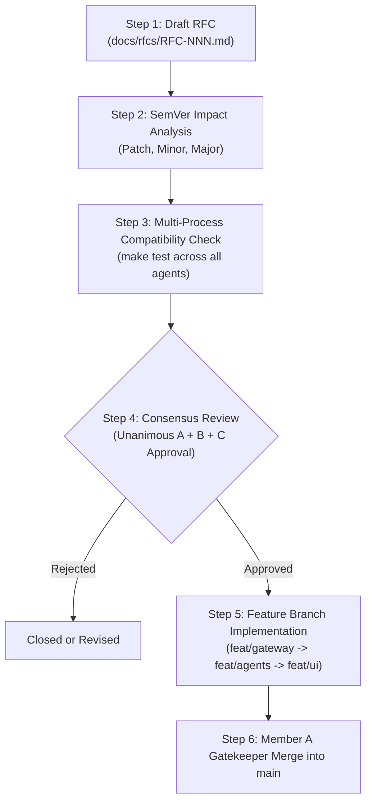

# NetCoop AI: Protocol & Contract Change Governance (v1.0.0)

This document formalizes the operational procedure for proposing, evaluating, and adopting changes to the NetCoop AI inter-agent contract, wire protocols, schema definitions, and microservice interfaces.

---

## 1. Core Principle: Mandatory Three-Member Consensus

No individual developer or subsystem owner (Member A, Member B, or Member C) may unilaterally modify:
- `/schemas/*.json` (Envelope, Telemetry, Diagnostic Report, Remediation Plan)
- Port allocations or microservice endpoints (`/core/config.py`)
- Wire envelope serialization models (`core/envelope.py`)
- Gateway ingestion interfaces (`/gateway/api.py`, `OrganizerAdapter`)
- WebSocket event payloads (`/ws/events`)

**Every proposed contract modification requires unanimous agreement from all three team members before any code is merged into `main`.**

---

## 2. Team Member Review Responsibilities

| Role | Domain Authority | Contract Review Focus |
| :--- | :--- | :--- |
| **Member A** (Integrator & Lead) | Orchestrator, Core Protocol, State Graph | Verifies backward compatibility, LangGraph state machine stability, conflict resolution determinism, and SQLite audit logging integrity. |
| **Member B** (Specialist Agents) | Domain Specialist Microservices (Ports 8001–8005) | Verifies that domain agents can parse modified fields without regression, that SI units remain unambiguous, and that evidence scoring is unaffected. |
| **Member C** (Gateway & UI) | Gateway (Port 8006), REST/WS (Port 8000), Dashboard | Verifies that Gateway adapters correctly normalize external inputs, that WebSocket streamers deliver expected fields, and that dashboard components render without errors. |

---

## 3. Contract Change Workflow



### Step 1: Draft RFC
The proposing member creates a markdown RFC in `/docs/rfcs/` specifying:
- **Motivation**: Why the current contract is insufficient.
- **Affected Artifacts**: JSON Schemas, port mappings, or Pydantic models.
- **Proposed Diff**: Exact JSON Schema and model changes.
- **Backward Compatibility Plan**: How existing scenarios and tests continue to function.

### Step 2: SemVer Impact Classification
- **Patch (1.0.x)**: Non-breaking clarifications, comments, docstring updates, or expanded regex aliases in the Gateway adapter.
- **Minor (1.x.0)**: New optional fields in `EnvelopePayload` or new message types that unupdated agents can safely ignore.
- **Major (2.0.0)**: Breaking changes to required fields, modified port assignments, or changed SI units. Requires unanimous agreement and simultaneous branch updates.

### Step 3: Automated Contract Validation
Before review, the proposer must run:
```bash
make test
pytest tests/test_protocol_envelope.py tests/test_agent_http.py tests/test_gateway_api.py -v
```
All schema validation and microservice HTTP tests must pass cleanly.

### Step 4: Three-Way Sign-Off Gate
All three members must record explicit written consensus in the RFC tracking table:

```markdown
| Team Member | Decision | Date | Notes |
| :--- | :---: | :---: | :--- |
| Member A (Lead / Orchestrator) | APPROVED | 2026-10-31 | Verified backward compatibility with LangGraph |
| Member B (Specialist Agents)   | APPROVED | 2026-10-31 | Verified agent parser compatibility |
| Member C (Gateway & UI)        | APPROVED | 2026-10-31 | Verified dashboard and WebSocket format |
```

### Step 5: Implementation and Staged Merge
Once approved:
1. Member C updates `feat/gateway` (adapters and schemas).
2. Member B updates `feat/agents` (agent implementations).
3. Member C updates `feat/ui` (WebSocket streaming and dashboard).
4. Member A verifies tests and merges `feat/gateway`, `feat/agents`, and `feat/ui` sequentially into `main`.

---

## 4. Inviolable Invariants (Non-Negotiable)

1. **Zero Hallucination**: No contract change may allow an agent to declare a definitive diagnosis when corroborating evidence is missing or ambiguous. The status `insufficient_evidence` must remain preserved.
2. **Offline Core Pipeline**: The core multi-agent diagnosis must execute completely offline with zero mandatory internet or LLM dependencies.
3. **Simulated Remediation Only**: All remediation definitions in `schemas/remediation_plan.json` must remain strictly simulated; commands may never be executed on real network interfaces.
4. **Isolated Memory**: Agents must communicate solely through HTTP payloads conforming to `schemas/envelope.json`. In-process memory sharing or shared mutable state is prohibited.
5. **Monochrome Design Tokens**: Any UI or CLI output additions must adhere strictly to the monochrome design tokens (#FAFAF9 / #0F0F10, slate #475569, box.SQUARE, zero emojis).

