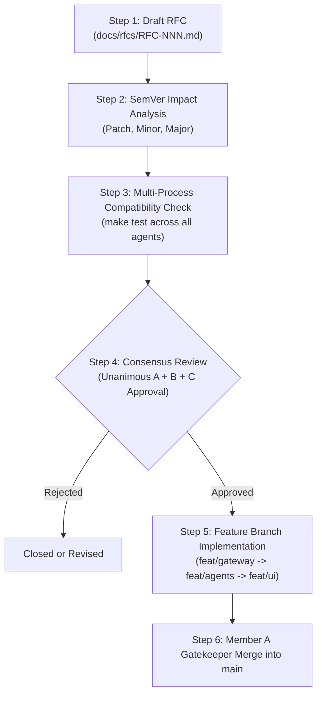

# NetCoop AI: Protocol & Contract Change Governance (v1.0.0)

This document formalizes the operational procedure for proposing, evaluating, and adopting changes to the NetCoop AI inter-agent contract, wire protocols, schema definitions, and microservice interfaces.

---

## 1. Core Principle: Mandatory Three-Member Consensus

No individual developer or subsystem owner (Member A, Member B, or Member C) may unilaterally modify:
- `/schemas/*.json` (Envelope, Telemetry, Diagnostic Report, Remediation Plan)
- Port allocations or microservice endpoints (`/core/config.py`)
- Wire envelope serialization models (`core/envelope.py`)
- Gateway ingestion interfaces (`/gateway/api.py`, `OrganizerAdapter`)
- WebSocket event payloads (`/ws/events`)

**Every proposed contract modification requires unanimous agreement from all three team members before any code is merged into `main`.**

---

## 2. Team Member Review Responsibilities

| Role | Domain Authority | Contract Review Focus |
| :--- | :--- | :--- |
| **Member A** (Integrator & Lead) | Orchestrator, Core Protocol, State Graph | Verifies backward compatibility, LangGraph state machine stability, conflict resolution determinism, and SQLite audit logging integrity. |
| **Member B** (Specialist Agents) | Domain Specialist Microservices (Ports 8001–8005) | Verifies that domain agents can parse modified fields without regression, that SI units remain unambiguous, and that evidence scoring is unaffected. |
| **Member C** (Gateway & UI) | Gateway (Port 8006), REST/WS (Port 8000), Dashboard | Verifies that Gateway adapters correctly normalize external inputs, that WebSocket streamers deliver expected fields, and that dashboard components render without errors. |

---

## 3. Contract Change Workflow



### Step 1: Draft RFC
The proposing member creates a markdown RFC in `/docs/rfcs/` specifying:
- **Motivation**: Why the current contract is insufficient.
- **Affected Artifacts**: JSON Schemas, port mappings, or Pydantic models.
- **Proposed Diff**: Exact JSON Schema and model changes.
- **Backward Compatibility Plan**: How existing scenarios and tests continue to function.

### Step 2: SemVer Impact Classification
- **Patch (1.0.x)**: Non-breaking clarifications, comments, docstring updates, or expanded regex aliases in the Gateway adapter.
- **Minor (1.x.0)**: New optional fields in `EnvelopePayload` or new message types that unupdated agents can safely ignore.
- **Major (2.0.0)**: Breaking changes to required fields, modified port assignments, or changed SI units. Requires unanimous agreement and simultaneous branch updates.

### Step 3: Automated Contract Validation
Before review, the proposer must run:
```bash
make test
pytest tests/test_protocol_envelope.py tests/test_agent_http.py tests/test_gateway_api.py -v
```
All schema validation and microservice HTTP tests must pass cleanly.

### Step 4: Three-Way Sign-Off Gate
All three members must record explicit written consensus in the RFC tracking table:

```markdown
| Team Member | Decision | Date | Notes |
| :--- | :---: | :---: | :--- |
| Member A (Lead / Orchestrator) | APPROVED | 2026-10-31 | Verified backward compatibility with LangGraph |
| Member B (Specialist Agents)   | APPROVED | 2026-10-31 | Verified agent parser compatibility |
| Member C (Gateway & UI)        | APPROVED | 2026-10-31 | Verified dashboard and WebSocket format |
```

### Step 5: Implementation and Staged Merge
Once approved:
1. Member C updates `feat/gateway` (adapters and schemas).
2. Member B updates `feat/agents` (agent implementations).
3. Member C updates `feat/ui` (WebSocket streaming and dashboard).
4. Member A verifies tests and merges `feat/gateway`, `feat/agents`, and `feat/ui` sequentially into `main`.

---

## 4. Inviolable Invariants (Non-Negotiable)

1. **Zero Hallucination**: No contract change may allow an agent to declare a definitive diagnosis when corroborating evidence is missing or ambiguous. The status `insufficient_evidence` must remain preserved.
2. **Offline Core Pipeline**: The core multi-agent diagnosis must execute completely offline with zero mandatory internet or LLM dependencies.
3. **Simulated Remediation Only**: All remediation definitions in `schemas/remediation_plan.json` must remain strictly simulated; commands may never be executed on real network interfaces.
4. **Isolated Memory**: Agents must communicate solely through HTTP payloads conforming to `schemas/envelope.json`. In-process memory sharing or shared mutable state is prohibited.
5. **Monochrome Design Tokens**: Any UI or CLI output additions must adhere strictly to the monochrome design tokens (#FAFAF9 / #0F0F10, slate #475569, box.SQUARE, zero emojis).

---

## 5. Remediation Simulation & Human-in-the-Loop (HITL) Contract Extensions

To support Member C's interactive dashboard remediation tabs and Member A's HITL approval checkpoints, the platform defines the following backward-compatible API endpoints and payload schemas:

### 5.1 In-Memory Simulation Endpoint: `POST /api/remediate/simulate`

Applies an action to in-memory scenario telemetry without modifying production state or touching real network sockets. Returns before/after metric deltas and verification status.

#### Request Payload (`application/json`)
```json
{
  "scenario_or_incident_id": "link_congestion.json",
  "action_type": "rebalance traffic",
  "device": "spine-01",
  "interface": "et-0/0/1",
  "peer_device": "spine-02",
  "operator": "operator_alice"
}
```

#### Field Specifications
| Field | Type | Required | Description | Allowed Values |
| :--- | :--- | :---: | :--- | :--- |
| `scenario_or_incident_id` | String | No | Target scenario filename or existing incident ID | e.g. `"link_congestion.json"`, `"inc-1001"` |
| `incident_data` | Object | No | Inline telemetry object (optional override) | Conforming to `schemas/telemetry.json` |
| `action_type` | String | Yes | Action to apply to in-memory state | `"rebalance traffic"`, `"clear interface counters"`, `"raise QoS priority"`, `"fail over a link"`, `"harmonize mtu"` |
| `device` | String | No | Specific device identifier to target | e.g. `"spine-01"`, `"SW_CAMPUS_1"` (inferred if omitted) |
| `interface` | String | No | Interface name on target device | default: `"et-0/0/1"` |
| `peer_device` | String | No | Redundant failover peer device | e.g. `"spine-02"` |
| `operator` | String | No | Identifier of the operator or agent triggering simulation | default: `"operator"` |

#### Response Payload (`application/json`, Status `200 OK`)
```json
{
  "status": "success",
  "disclaimer": "Simulated, no production changes",
  "is_simulated": true,
  "action_type": "Rebalance traffic across ECMP next-hops from spine-01 et-0/0/1",
  "target_device": "spine-01",
  "target_interface": "et-0/0/1",
  "safety_passed": true,
  "safety_checks": [
    {
      "check_name": "simulation_safety_gate",
      "passed": true,
      "details": "Action strictly configured for simulation sandbox."
    },
    {
      "check_name": "blast_radius_limit",
      "passed": true,
      "details": "Impacts 1/2 devices (50%). Boundary is 60%."
    },
    {
      "check_name": "rollback_readiness",
      "passed": true,
      "details": "Rollback script verified for high/medium risk actions."
    }
  ],
  "executed_commands": [
    "configure terminal",
    "interface et-0/0/1",
    "load-interval 30",
    "traffic-policy REBALANCE_ECMP",
    "commit and-quit"
  ],
  "rollback_commands": [
    "configure terminal",
    "interface et-0/0/1",
    "no traffic-policy REBALANCE_ECMP",
    "commit and-quit"
  ],
  "before_metrics": {
    "max_link_utilization_pct": 94.2,
    "avg_link_utilization_pct": 82.5,
    "max_queue_drops": 4500.0,
    "avg_queue_drops": 2250.0
  },
  "after_metrics": {
    "max_link_utilization_pct": 42.39,
    "avg_link_utilization_pct": 37.12,
    "max_queue_drops": 0.0,
    "avg_queue_drops": 0.0
  },
  "delta": {
    "max_link_utilization_pct": -51.81,
    "avg_link_utilization_pct": -45.38,
    "max_queue_drops": -4500.0,
    "avg_queue_drops": -2250.0
  }
}
```

---

### 5.2 Operator HITL Approval Execution: `POST /api/incidents/{incident_id}/remediate`

Member A's HITL gate requires explicit operator approval before executing simulated commands and recording audit trails in SQLite.

#### Request Payload
```json
{
  "action_id": "act-rebalance-spine-01",
  "operator": "network_engineer_bob"
}
```

#### Response Payload
```json
{
  "success": true,
  "disclaimer": "Simulated, no production changes",
  "is_simulated": true,
  "message": "Successfully simulated remediation action act-rebalance-spine-01 on spine-01.",
  "executed_commands": [
    "configure terminal",
    "interface et-0/0/1",
    "load-interval 30",
    "traffic-policy REBALANCE_ECMP",
    "commit and-quit"
  ],
  "rollback_commands": [
    "configure terminal",
    "interface et-0/0/1",
    "no traffic-policy REBALANCE_ECMP",
    "commit and-quit"
  ],
  "action": {
    "action_id": "act-rebalance-spine-01",
    "status": "simulated_success",
    "risk_level": "low"
  }
}
```

---

### 5.3 MCP Protocol Extensions

The Model Context Protocol server (`netcoop/mcp/server.py`) exposes these exact simulation capabilities through JSON-RPC 2.0 tool invocation:

- `simulate_remediation`: Accepts `incident_id`, `action_id`, and `action_type`.
- `explain_finding`: Returns root cause analysis and evidentiary metric breakdowns for any finding ID.
- `get_telemetry`: Returns recent telemetry windows for specific network nodes.
- `get_topology`: Returns topology graph or gracefully reports `"topology unavailable"`.
- `run_diagnosis`: Runs diagnosis against scenario files, organizer samples, or inline telemetry.
- `list_devices`: Enumerates known devices across all loaded contexts.
- Resources (`scenario://*`, `organizer://*`, `report://latest`).
