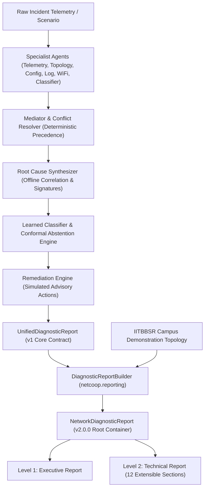

# NetCoop AI — Two-Level Network Diagnostic Report Contract Specification

## 1. Architectural Overview

The NetCoop AI Network Diagnostic Report architecture provides a versioned, typed contract separating diagnostic outcomes into two logical views:

1. **Level 1 — Executive Report**: A concise operational summary tailored for operations leadership, incident commanders, and service desk escalation teams. It captures the essential state of the network, probable root cause (or explicit abstention), affected devices, affected physical campus zones (with strict separation between machine `site_id` and human-readable `site_name`), key health observations, advisory recommendations, and independent recovery verification status.
2. **Level 2 — Technical Report**: A detailed, extensible, and fully auditable technical breakdown for network reliability engineers and root-cause specialists. It contains 12 structured technical sections capturing raw and normalized telemetry, topology hop paths, anomaly detections, evaluated hypotheses, evidence chains with stable identifiers, specialist agent execution states, mediator conflict resolution, confidence calibration (including split-conformal prediction sets), and SQLite audit replay trace references.



---

## 2. Report Field Provenance Mapping

Every field in the report maps deterministically to an upstream component. No field is hardcoded or fabricated.

| Report Field | Type / Nullability | Upstream Source Component | Description / Provenance Rule |
| :--- | :--- | :--- | :--- |
| `schema_version` | `str` (Const: `"2.0.0"`) | `NetworkDiagnosticReport` | Contract schema version for API compatibility. |
| `report_id` | `str` | `DiagnosticReportBuilder` | Deterministic or generated UUID with prefix `rep-`. |
| `incident_id` | `str` | Gateway Ingestion / Scenario | Identifier matching `incident_data["incident_id"]`. |
| `network_id` | `str` | Gateway Ingestion / Scenario | Identifier matching `incident_data["network_id"]`. |
| `created_at` | `str` (ISO 8601 UTC) | Report Engine Runtime | Real-time generation timestamp in UTC. |
| **Executive: `diagnostic_status`** | `DiagnosticStatus` enum | `SynthesizerAgent` / State | `"diagnosed"`, `"insufficient_evidence"`, `"abstained"`, `"inconclusive"`, or `"benign"`. |
| **Executive: `severity`** | `ReportSeverity` enum | `OfflineCorrelationEngine` | Maximum severity across corroborated evidence (`critical` > `warning` > `info`). |
| **Executive: `confidence`** | `float` (0.0-1.0) or `null` | Learned Classifier / Synthesizer | Calibrated confidence when genuinely available; `null` if diagnosis abstains. |
| **Executive: `confidence_category`** | `str` or `null` | Conformal Engine | `"high"`, `"medium"`, `"low"`, `"abstain"`, or `null`. |
| **Executive: `is_confidence_calibrated`** | `bool` | Classifier Calibration Pipeline | `true` if probability was calibrated via empirical split-conformal / isotonic scaling; `false` if heuristic. |
| **Executive: `confidence_type`** | `str` or `null` | Report Builder | `"calibrated_probability"`, `"uncalibrated_heuristic"`, or `null` (when abstained). |
| **Executive: `affected_devices`** | `List[str]` | Top Hypothesis / Scope | Devices isolated by multi-agent investigation. |
| **Executive: `affected_site_ids`** | `List[str]` | IITBBSR Topology Fixture | Stable machine site identifiers (e.g., `["site_admin", "zone_academic"]`). |
| **Executive: `affected_site_names`** | `List[str]` | IITBBSR Topology Fixture | Human-readable campus locations (e.g., `["Administrative Building", "Academic zone"]`). |
| **Executive: `probable_root_cause`** | `str` or `null` | Top Hypothesis / Synthesizer | Title of probable root cause; `null` if insufficient evidence or abstained. |
| **Executive: `root_cause_status`** | `RootCauseStatus` enum | Synthesizer / Abstention Engine | `"probable"`, `"unverified_hypothesis"`, `"inconclusive"`, or `"abstained"`. |
| **Executive: `executive_summary`** | `str` | `ReportBuilder` | Synthesized plain-text overview of the diagnosis and scope impact. |
| **Executive: `key_observations`** | `List[MetricObservation]` | Specialist Observations | Empirical metric observations with value, unit, source, timestamp, and severity. |
| **Executive: `supporting_evidence_summary`** | `str` | `OfflineCorrelationEngine` | Summary of corroborated domains and evidence counts. |
| **Executive: `agent_investigation_status`** | `List[AgentInvestigationRecord]` | LangGraph Orchestrator | Audit records for specialist agents (`queued`, `running`, `completed`, `failed`, `skipped`). |
| **Executive: `recommended_actions`** | `List[RecommendedAction]` | `RemediationEngine` | Advisory remediation actions tagged with `is_simulated=True` and advisory notice. |
| **Executive: `recovery_verification_status`** | `RecoveryStatus` enum | Post-Remediation Monitor | Independent verification (`pending_verification`, `recovered`, `not_recovered`, `not_applicable`). |
| **Executive: `data_provenance`** | `Dict[str, Any]` | Orchestrator Metadata | Source pipeline, timestamp, and adapter attribution. |
| **Executive: `limitations`** | `List[str]` | Synthesis / Correlation | Uncorroborated domains, missing telemetry fields, or simulation boundaries. |
| **Technical: `sections`** | `List[TechnicalSection]` | 12 Extensible Sections | Structured technical diagnostic sections ordered 1 through 12, each tracking availability. |
| **`topology_reference`** | `CampusTopologyReference` or `null` | `data/campus/iitbbsr_demo_topology.json` | Demonstration campus mapping, affected nodes, site IDs, site names, and logical paths. |
| **`audit`** | `AuditReference` or `null` | SQLite DB (`incidents`, `envelope_logs`) | Verified checkpoint IDs, correlation IDs, envelope counts, and replay references. |

---

## 3. Data Integrity and Scientific Defensibility Rules

1. **Anti-Fabrication and Metric Nullability**:
   Missing metrics must be represented as `null` with `is_available: false`. They must never be defaulted to 0 or populated with placeholder values. Every metric observation must state its measurement unit, reporting agent, and collection timestamp.
2. **Explicit Abstention Guarantee**:
   When the root cause synthesizer or conformal classifier determines that evidence is insufficient or contradictory, the report explicitly sets `diagnostic_status: "insufficient_evidence"` or `"abstained"`, sets `probable_root_cause: null`, and sets `confidence: null`. No root-cause label is ever forced.
3. **Calibrated Confidence**:
   The report distinguishes uncalibrated heuristic scores from calibrated probabilities. When hybrid scoring is active, the report records `rules_score`, `model_score`, `blended_score`, `calibrated_confidence`, and the `conformal_prediction_set`. Uncalibrated outputs are explicitly marked with `is_confidence_calibrated: false` and `confidence_type: "uncalibrated_heuristic"`.
4. **Advisory Remediation and Simulation Boundary**:
   All remediation actions have `is_simulated: true`, `is_advisory: true`, and include the explicit disclaimer: *"Action is advisory and simulated only. No production network change has occurred."* Actions carry lifecycle statuses (`proposed`, `approved`, `simulated`, `blocked`, `verified`, `rejected`). Configuration commands are sourced directly from pre-defined safe catalogs (`RemediationCatalog`), never fabricated as arbitrary network modifications.
5. **Decoupled Recovery Verification**:
   The recovery status of the physical network is tracked independently of the diagnostic conclusion. An incident may be completely diagnosed (`diagnostic_status: "diagnosed"`) while its recovery state remains `"pending_verification"` or `"not_recovered"`.
6. **Traceable Evidence Identifiers**:
   Every evidence item is assigned a stable identifier (`evi-xxx`) that persists across serialization, arbitration, and database logging.
7. **Audit Truthfulness**:
   The report only asserts `audit_logged: true` when a genuine database record exists in persistent SQLite storage (`IncidentRecord` or `EnvelopeLog`). When no record is found, `audit_logged: false` is reported with explicit documentation.

---

## 4. Level 1 — Executive Report Specification

The Executive Report provides an immediate, high-level operational briefing:

```json
{
  "report_id": "rep-48e92c7325",
  "incident_id": "inc-demo-iitbbsr-001",
  "generated_timestamp": "2026-11-01T00:30:00Z",
  "diagnostic_status": "diagnosed",
  "severity": "critical",
  "confidence": 0.884,
  "confidence_category": "high",
  "is_confidence_calibrated": true,
  "confidence_type": "calibrated_probability",
  "affected_devices": [
    "IITBBSR-CORE-RTR-01",
    "IITBBSR-AGG-ACAD-01"
  ],
  "affected_site_ids": [
    "site_admin",
    "zone_academic"
  ],
  "affected_site_names": [
    "Administrative Building",
    "Academic zone"
  ],
  "probable_root_cause": "Optical Transceiver Degradation",
  "root_cause_status": "probable",
  "executive_summary": "Diagnosed Optical Transceiver Degradation affecting trunk link between Administrative Building Core and Academic Zone Aggregation router.",
  "key_observations": [
    {
      "metric_name": "optical_tx_power_dbm",
      "value": -13.2,
      "unit": "dbm",
      "entity": "IITBBSR-CORE-RTR-01:HundredGigE0/0/0/0",
      "source": "telemetry_agent",
      "timestamp": "2026-11-01T00:30:00Z",
      "severity": "critical",
      "is_available": true
    },
    {
      "metric_name": "ambient_temperature_celsius",
      "value": null,
      "unit": null,
      "entity": null,
      "source": "telemetry_collector",
      "timestamp": null,
      "severity": "unknown",
      "is_available": false
    }
  ],
  "supporting_evidence_summary": "Corroborated across 3 evidence records from 2 specialist agents.",
  "agent_investigation_status": [
    {
      "agent_role": "telemetry_agent",
      "agent_name": "Telemetry Specialist",
      "status": "completed",
      "observations_count": 2,
      "findings_summary": "Participated and contributed 2 evidence records."
    }
  ],
  "recommended_actions": [
    {
      "action_id": "act-drain-IITBBSR-CORE-RTR-01",
      "title": "Drain and reroute traffic off degraded optical link IITBBSR-CORE-RTR-01:HundredGigE0/0/0/0",
      "description": "Increase IGP metric to max to smoothly reroute traffic to redundant link before transceiver replacement.",
      "target_device": "IITBBSR-CORE-RTR-01",
      "commands": [
        "configure terminal",
        "router isis backbone",
        "interface HundredGigE0/0/0/0",
        "metric 16777214",
        "commit and-quit"
      ],
      "rollback_commands": [
        "configure terminal",
        "router isis backbone",
        "interface HundredGigE0/0/0/0",
        "no metric 16777214",
        "commit and-quit"
      ],
      "risk_level": "medium",
      "blast_radius_devices": [
        "IITBBSR-CORE-RTR-01",
        "IITBBSR-AGG-ACAD-01"
      ],
      "is_simulated": true,
      "status": "proposed",
      "is_advisory": true,
      "advisory_notice": "Action is advisory and simulated only. No production network change has occurred."
    }
  ],
  "recovery_verification_status": "pending_verification",
  "limitations": [
    "Remediation actions are simulated proposals only.",
    "Topology references denote demonstration campus inventory."
  ]
}
```

---

## 5. Level 2 — Technical Report Specification (12 Extensible Sections)

The Technical Report is organized into 12 structured, extensible sections with explicit availability tracking:

| Section Order | Section ID | Title | Scope and Content | Availability Condition |
| :---: | :--- | :--- | :--- | :--- |
| **1** | `incident_context` | Incident and Diagnostic Context | Incident ID, network ID, timestamps, duration ms, device and interface scope. | Always available. |
| **2** | `input_telemetry` | Input Telemetry and Normalization | Ingestion coverage, normalized metric units, entities evaluated, missing fields. | Available if telemetry records exist. |
| **3** | `topology_and_paths` | Topology Context and Affected Paths | Campus topology linkage, affected nodes, site IDs, site names, and multi-hop logical paths. | Available if topology mapped. |
| **4** | `anomaly_detection` | Anomaly and Fault-Detection Findings | Metric anomaly detections filtered against baseline thresholds and z-scores. | Available if anomalies detected. |
| **5** | `hypotheses_evaluation` | Root-Cause Hypotheses and Causal Inference | Evaluated causes, causal chains, uncertainty scores, and alternative hypotheses. | Available if hypotheses formed. |
| **6** | `evidence_records` | Evidence Records and Source References | Normalized, traceable evidence inventory with stable IDs (`evi-xxx`) and weights. | Available if evidence collected. |
| **7** | `specialist_findings` | Specialist-Agent Findings Breakdown | Findings grouped by specialist agent (`telemetry`, `config`, `log`, `wifi`, etc.). | Available if agents contributed. |
| **8** | `arbitration` | Mediator Arbitration and Conflict Resolution | Contradictory hypotheses, evidence precedence hierarchy, and inquiry traces. | Always available (states resolution or concordant status). |
| **9** | `confidence_calibration` | Confidence Calibration and Statistical Abstention | Rules score, model score, blended score, conformal prediction set, calibration tier. | Available only if ML calibrated. |
| **10** | `remediation_plan` | Recommended Remediation and Approval State | Simulated CLI commands, rollback commands, blast radius, risk level, gate status. | Available if actions proposed. |
| **11** | `audit_replay` | Audit and Replay Trace References | Persistent SQLite incident IDs, checkpoint iteration, and envelope correlation IDs. | Available only if logged in DB. |
| **12** | `recovery_limitations` | Recovery Verification and Data Limitations | Independent recovery status, residual ambiguity reasons, and uncorroborated domains. | Always available. |

---

## 6. IIT Bhubaneswar Demonstration Topology Interoperability

The report integrates with the demonstration campus model defined in:
- Dataset: `data/campus/iitbbsr_demo_topology.json`
- Schema: `schemas/campus_topology.schema.json`
- Documentation: `docs/iitbbsr_topology.md`

### Topology Resolution
- The builder automatically maps affected network devices (e.g. `IITBBSR-CORE-RTR-01`) to stable machine site IDs (`site_admin`) and human-readable site names (`Administrative Building`) as well as logical routing paths (`PATH-DEMO-CORE-SBS-01`).
- The report maintains strict separation between synthetic demonstration topology metadata and empirical telemetry.
- It includes the mandatory provenance disclaimer:
  *"All network equipment, nodes, links, and paths are synthetic demonstration inventory. Official campus maps establish physical building landmarks only and contain zero network routing equipment records."*
- Absolute GPS coordinates are never emitted; visual layouts rely on normalized canvas space `[0.0, 1.0]`.

---

## 7. JSON Schema and Test Validation

- Schema Definition: `schemas/network_diagnostic_report.schema.json`
- Synthetic Fixture: `data/fixtures/synthetic_diagnostic_report.json`
- Test Suite: `tests/test_reporting_contract.py` (15/15 passed)

Validation command:
```powershell
.venv\Scripts\python.exe -m pytest tests/test_reporting_contract.py -v
```
